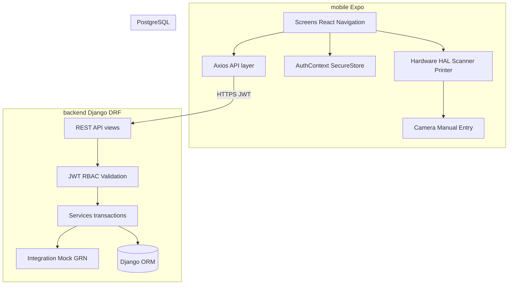
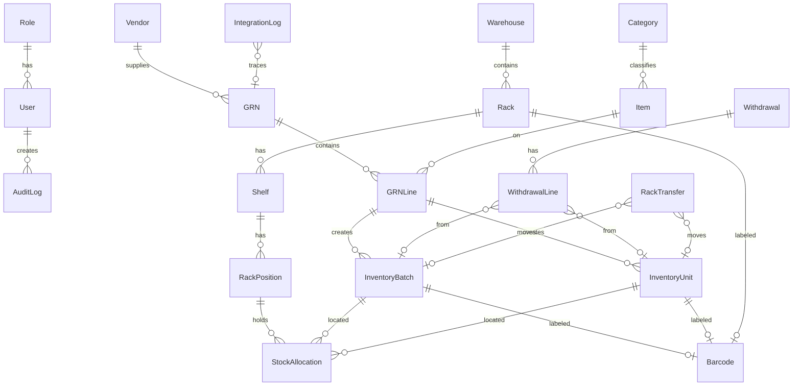

# Warehouse Inventory Management — Architecture & Demo Plan

> Readable Markdown copy of `warehouse_mvp_architecture_e3b06dfa.plan.md` (Cursor plan files can look odd in raw editor).

## Workspace status

`D:\Projects\MMT-Pune` already contains a working monorepo:

- `backend/` — Django + DRF + SimpleJWT + PostgreSQL
- `mobile/` — Expo + React Native + TypeScript + React Navigation
- `docs/` — architecture, API, deployment, demo guide

An earlier draft of this file incorrectly described **Express + Prisma + MySQL**. That stack is **rejected**. Use only the mandatory stack below.

## Concrete stack decisions (locked)

- **Mobile:** Expo (SDK current stable) + TypeScript + **React Navigation** + Axios + SecureStore
- **Backend:** Python + Django + Django REST Framework + SimpleJWT + drf-spectacular
- **Database:** PostgreSQL via Django ORM (source of truth)
- **Barcodes:** Code 128; camera + manual entry for demo; Zebra HAL stubs only
- **Local DB:** PostgreSQL via Docker Compose (`.env`); SQLite only for local tests via `DJANGO_USE_SQLITE=1`
- **Roles:** `ADMIN`, `SUPERVISOR`, `WAREHOUSE_EMPLOYEE` — FIFO override for ADMIN/SUPERVISOR with mandatory reason + audit log

---

## 1. Final architecture



**Module boundaries (backend):** `accounts`, `warehouses`, `inventory`, `grn`, `barcodes`, `withdrawals`, `reports`, `integrations`, `audit`

**Inventory model:**

- Bulk → one `InventoryBatch` + one barcode; qty fields (`received`, `available`, `withdrawn`, `reserved`)
- Unit → N `InventoryUnit` rows + N barcodes; status lifecycle
- Both link to `GRN` / `GRNLine` and optional planned vs actual `StockAllocation`

**Critical write paths** (`transaction.atomic()` + `select_for_update()`):

- Create/import GRN → generate inventory/barcodes
- Allocate / transfer
- Withdraw with FIFO check

---

## 2. Database ER diagram

Same flow as the shared client ERD: auth → warehouse hierarchy → GRN receive → batch/unit stock → allocate / withdraw / transfer. (`InventoryTransaction` is an immutable ledger behind transfers/withdrawals; kept in the table list below, not drawn here.)



---

## 3. Tables and relationships

| Table | Purpose | Key rules |
|---|---|---|
| `Role` | ADMIN / SUPERVISOR / WAREHOUSE_EMPLOYEE | Seeded fixed roles |
| `User` | Login, name, role, active | Django password hashing |
| `Warehouse` | Top location | 3 seeded |
| `Rack` | Rack + unique barcode | barcode unique globally |
| `Shelf` / `RackPosition` | Hierarchy under rack | unique per parent |
| `Category` / `Vendor` / `Item` | Master data | Item has `inventory_type`: BULK or UNIT |
| `GRN` | Header: number, external system, vendor, date, status | Unique `grn_number`; unique external ref when set |
| `GRNLine` | Item, qty, UOM, testing, classification | Creates batches/units on import |
| `InventoryBatch` | batch code, qtys, testing, received_at | FIFO by `received_at` + id |
| `InventoryUnit` | unit code, status, testing, received_at | One barcode each |
| `Barcode` | unique value, entity type BATCH/UNIT/RACK | Code 128 label PNG generated by backend |
| `StockAllocation` | planned vs actual location | supports split batch qty |
| `InventoryTransaction` | Immutable ledger | RECEIVE, ALLOCATE, TRANSFER, WITHDRAW, FIFO_* |
| `Withdrawal` / `WithdrawalLine` | SHIPMENT / ASSEMBLY | Lines reference batch XOR unit |
| `RackTransfer` | source/dest positions | Creates transactions |
| `IntegrationLog` | Mock import attempts | Duplicate detection audit |
| `AuditLog` / `PrintLog` | Security + reprint history | Mandatory for FIFO override |

**FIFO (backend):** On withdraw of item X, if older AVAILABLE stock exists, reject with structured payload unless SUPERVISOR/ADMIN sends `override_reason` (persisted).

---

## 4. API architecture

- Base: `/api`, JSON, `Authorization: Bearer <jwt>`
- Errors: `{ code, message, details? }`
- Health: `GET /api/health/`
- Auth: login / refresh / logout / profile
- Dashboard, GRN, inventory, barcodes (including `/label.png`), warehouses, locations allocate/transfer, withdrawals, reports
- Swagger: `/api/docs/`

**Concurrency:** withdraw and transfer use `select_for_update()` inside transactions; never allow negative stock.

---

## 5. Mobile navigation (React Navigation)

```text
Auth stack
  Login
Main tabs
  Dashboard
  Inventory → List → BatchDetail | UnitDetail
  GRN → List → Detail → Import
  Scanner (camera + manual + simulate)
  Warehouse → List → RackDetail → Allocate | Transfer
  Withdrawal → Main → Confirm
  Reports
  Settings
```

Tab shortcuts: Scan, Receive (GRN), Racks, Withdraw, Reports.

Design tokens: light background, navy text, blue primary, green/orange/red semantic — reusable `Button`, `Card`, `Badge`, `FifoAlert`.

---

## 6. Demo development plan

| Phase | Deliverables | Status / exit criteria |
|---|---|---|
| **1 Architecture** | This plan + ER + API + navigation | **Done** |
| **2A Backend gaps** | Code 128 labels, RBAC, transfer locking, tests, admin | **Done** |
| **2B Mobile gaps** | Warehouse UX, withdrawal list, readable reports, label preview | **Done** |
| **3 Demo polish** | Docs, AGENTS.md, role walkthrough, loading/empty states | **Done** (dev only) |
| **4 Deploy / VPS** | VPS docs, EAS/APK, backups, live deploy | **Deferred** until approved |

**Demo seed (must-have):** Steel Bolt BATCH-001 (older) + BATCH-002 (newer); partial withdraw; rack transfer; unit withdraw; shipment + assembly; 3 warehouses / 10 racks / sample GRNs.

Demo login (README only): `admin` / `Demo@12345` (and `supervisor`, `employee`).

---

## 7. Technical risks

| Risk | Mitigation |
|---|---|
| VPS / PostgreSQL quirks | Local Docker first; deploy docs only; no auto-deploy |
| Expo camera vs device | Manual barcode entry always available |
| Concurrent over-withdraw | DB transactions + `select_for_update` |
| FIFO edge cases | FIFO scoped per item; override audited |
| Zebra untested | Keep HAL stubs; do not claim hardware complete |
| APK build time | EAS documented; start early when needed |

---

## 8. Postpone until after demo

- Real M1 / Workroom APIs (keep stubs + mock import)
- Live Zebra DataWedge / Link-OS
- Full permission matrix UI
- Offline-first sync
- Advanced reporting/export beyond current report screens

---

## 9. Repo layout

```text
MMT-Pune/
  mobile/          # Expo React Native
  backend/         # Django + DRF
  docs/            # architecture, database, api, demo, deployment
  docker-compose.yml
  README.md
```

**Do not deploy to VPS or commit production secrets without explicit approval.**

---

## Approval checklist

- [x] Stack: Expo + Django + PostgreSQL (not Express/MySQL)
- [x] Schema / FIFO / override rules
- [x] Demo scope vs postponed list
- [x] Proceed with gap closure on the existing codebase

